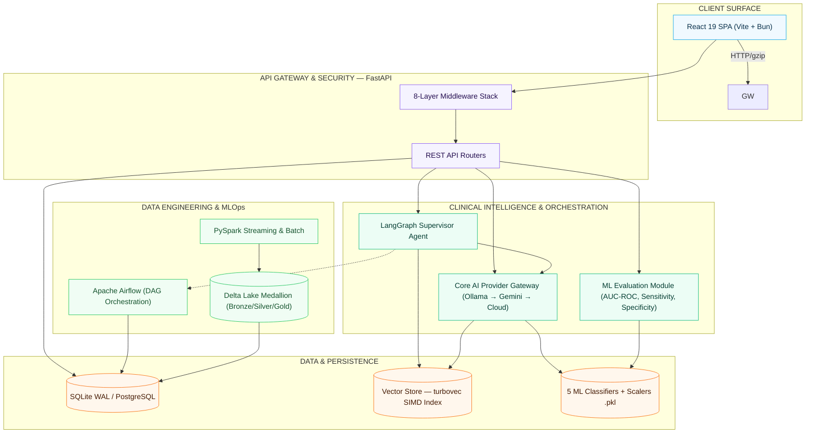
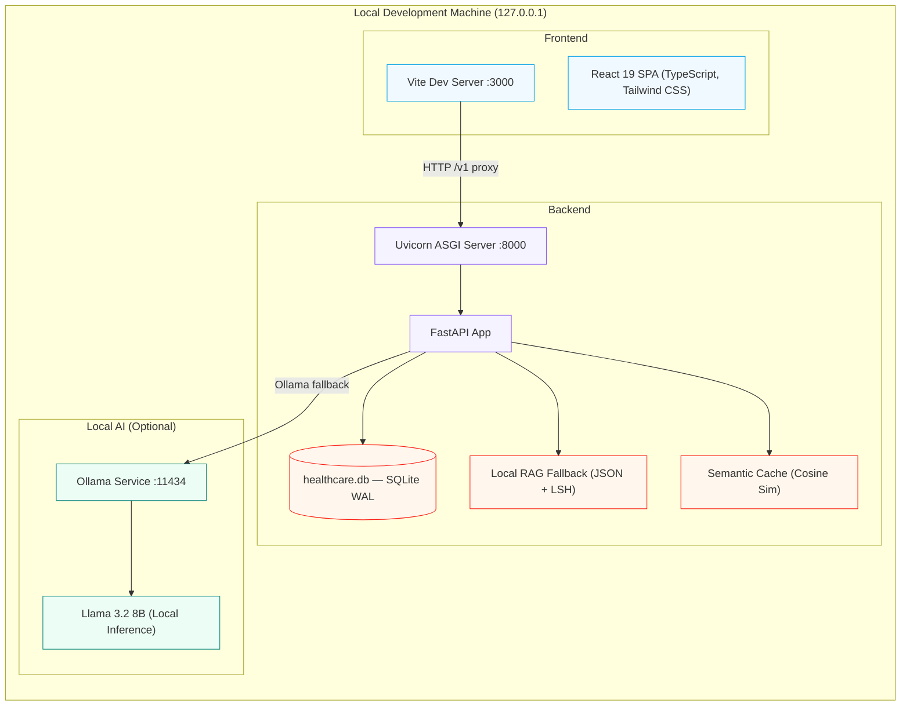
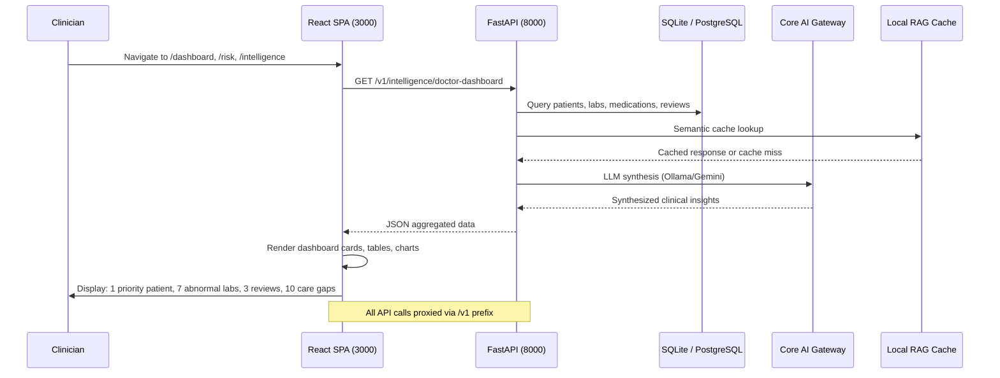
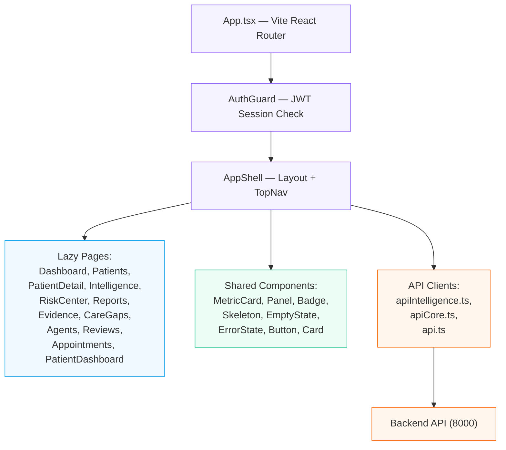
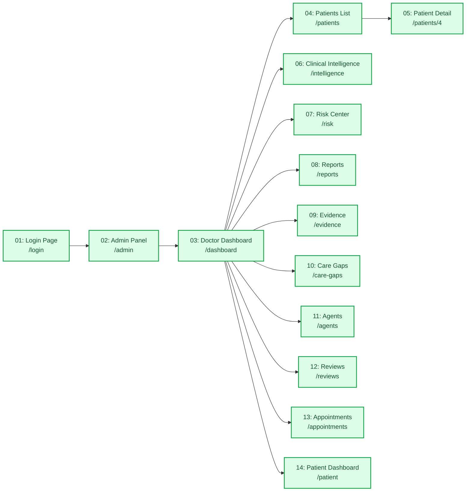

# AI Healthcare Intelligence — Architecture Diagram

## Overview

This document provides the canonical architecture diagram for the **AI Healthcare Intelligence** platform — a production-grade, privacy-first clinical decision support system built on FastAPI (backend), React 19 (frontend), and SQLite (demo database).

## System Architecture

## Demo Environment Architecture

The demo runs as two local processes on `127.0.0.1`:

## Intelligence API Data Flow

## Component Diagram (Frontend)

## Navigation Map — 14 Captured Views

